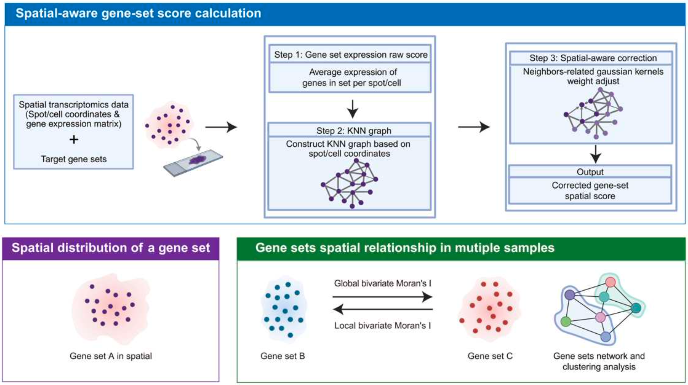

# SEMA: Spatial Expression Multiple-pathway Enrichment Analysis

SEMA is an R package for **spatially aware gene set scoring** in spatial
transcriptomics data. It first scores each spot/cell for a gene set, then
smooths the score over its spatial neighbors with a Gaussian kernel. The result
keeps regional patterns and is less affected by spot-level noise.

<div align="left"></div>

- **Gene set scoring:** score any number of gene sets per spot/cell. Use a
  simple mean, or a Seurat-style module score with matched control genes.
- **Spatially aware:** a k-nearest-neighbor graph and Gaussian kernel weights
  smooth each score toward its neighbors. `spatial_weight` sets how strongly.
- **Seurat friendly:** works directly on Seurat v4/v5 objects (Visium, Xenium,
  Slide-seq, ...), or on a plain expression matrix plus coordinates.
- **Fast:** sparse matrices, `RANN` for neighbor search and a C++ (Rcpp)
  kernel. The spatial graph is built once and shared by all gene sets.

For a full tutorial, see <https://kainmia.github.io/SEMA/>.

---

## Installation

```r
# install.packages("devtools")
devtools::install_github("KainMiA/SEMA")
```

SEMA contains C++ code, so a compiler is needed:
[Rtools](https://cran.r-project.org/bin/windows/Rtools/) on Windows, or the
Xcode command line tools on macOS.

**Requirements:** R >= 4.0, with `Seurat`, `Matrix`, `RANN`, `igraph`,
`ggplot2` and `Rcpp` (installed automatically).

---

## Quick start

```r
library(SEMA)
library(Seurat)

seurat_obj <- readRDS("demo_seurat_data.rds")

gene_sets <- list(
  Immune_Response = c("CD8A", "CD4", "FOXP3", "PDCD1", "CTLA4"),
  Angiogenesis    = c("VEGFA", "KDR", "PECAM1", "CD34"),
  Hypoxia         = c("HIF1A", "VEGFA", "SLC2A1", "PGK1")
)

# 1. Spatially aware scoring
sema_results <- RunSEMA(
  object         = seurat_obj,
  gene_sets      = gene_sets,
  assay          = "Spatial",
  raw_method     = "mean",
  k              = 6,
  spatial_weight = 0.5
)

# 2. Store the scores in the metadata (columns "SEMA_<gene set name>")
seurat_obj <- AddSEMAtoSeurat(seurat_obj, sema_results)

# 3. Plot on the tissue
SpatialFeaturePlot(
  seurat_obj,
  features = c("SEMA_Immune_Response", "SEMA_Angiogenesis", "SEMA_Hypoxia"),
  ncol     = 3
)
```

### Where coordinates come from

For Seurat objects, `RunSEMA()` looks for coordinates in this order:

1. the `coords` argument, if given: a two-column matrix with cell names as
   row names. Rows are matched to cells **by name**, so their order does not
   matter.
2. the dimensional reduction named by `reduction` (default `"spatial"`).
3. the tissue image (`GetTissueCoordinates()`), when the object has exactly
   **one** image.

If the object holds several tissue sections (several images), score each
section separately, or pass `coords` for one section. Otherwise spots from
different sections would be treated as neighbors.

### Using a plain expression matrix

```r
# expr:   genes x cells matrix (dense or sparse), normalized
# coords: cells x 2 matrix, same cell order as the columns of expr
res <- RunSEMA(expr, gene_sets, coords = coords, k = 6)
```

---

## How it works

1. **Raw score.** For each spot/cell, compute either:
   - the mean expression of the gene set (`raw_method = "mean"`), or
   - a module score (`raw_method = "addmodulescore"`): the gene set mean minus
     the mean of control genes drawn from the same expression bins.
2. **KNN graph.** Connect each spot to its `k` nearest neighbors in space. The
   graph is symmetric.
3. **Gaussian kernel.** Weight each edge by `exp(-d^2 / (2 h^2))`, where `d` is
   the distance and `h` is the bandwidth. By default, `h` is twice the median
   nearest-neighbor distance. The weights of each spot are normalized to sum
   to 1.
4. **Spatial score.** Combine the two:

   `spatial_score = (1 - spatial_weight) * raw_score + spatial_weight * neighbor_score`

   Here `neighbor_score` is the kernel-weighted average of the neighbors' raw
   scores.

---

## Main arguments of `RunSEMA()`

| Argument | Default | Description |
| --- | --- | --- |
| `object` | | A `Seurat` object, or a genes x cells expression matrix. |
| `gene_sets` | | Named `list` of character vectors, or a single character vector. Genes missing from the data are dropped; duplicates are removed. |
| `assay` | default assay | Assay to take expression from (Seurat only). |
| `slot` | `"data"` | Layer/slot to use (Seurat only). Works with Seurat v4 and v5. |
| `coords` | `NULL` | Coordinate matrix (cells x 2). Required for matrix input. |
| `reduction` | `"spatial"` | Reduction to read coordinates from (Seurat only). |
| `k` | `30` | Number of spatial neighbors. |
| `raw_method` | `"mean"` | `"mean"` or `"addmodulescore"`. |
| `spatial_weight` | `0.5` | `0` = raw score only, `1` = neighbors only. |
| `bandwidth` | `NULL` | Gaussian kernel bandwidth. `NULL` = estimated automatically. |
| `addmodulescore_params` | `list()` | Options for the module score: `n_bins` (24), `ctrl` (100), `seed` (123). |
| `verbose` | `TRUE` | Print progress messages. |

Misspelled arguments raise an error that suggests the right name (for example,
`method` -> `raw_method`).

---

## Output

- **Several gene sets:** a named list of class `SEMAresults`, with one
  `SEMAresult` per gene set. Unnamed gene sets are called `GeneSet1`,
  `GeneSet2`, ...
- **One gene set:** a single `SEMAresult`.

Each `SEMAresult` contains:

| Element | Description |
| --- | --- |
| `spatial_scores` | Spatially smoothed score, one value per spot/cell (same order as the cells). |
| `raw_scores` | Score before smoothing. |
| `neighbor_scores` | Kernel-weighted mean of the neighbors' raw scores. |
| `parameters` | `k`, `raw_method`, `spatial_weight` and the `bandwidth` used. |
| `raw_info` | Genes used (and control genes for `"addmodulescore"`). |
| `graph`, `adjacency_matrix`, `weighted_adjacency` | The KNN graph and the normalized kernel weights. |
| `coords` | Coordinates used. |

```r
head(sema_results$Hypoxia$spatial_scores)
hist(sema_results$Hypoxia$spatial_scores, main = "Hypoxia", xlab = "SEMA score")
```

---

## Visualization

```r
res <- sema_results$Hypoxia

VisualizeSEMA(res)                          # spatial scores
VisualizeSEMA(res, type = "comparison")     # raw vs spatial, side by side
VisualizeSEMA(res, color_palette = "rdbu")  # diverging palette
VisualizeSpatialGraph(res)                  # KNN graph colored by degree
VisualizeSpatialGraph(res, color_by = "score")
```

---

## Other functions

| Function | Purpose |
| --- | --- |
| `CalculateSEMA()` / `CalculateMultipleSEMAs()` | Lower-level scoring for one or many gene sets (matrix input). |
| `AddSEMAtoSeurat()` | Add scores to Seurat metadata (`use_spatial_scores = FALSE` adds raw scores). |
| `AddModuleScoreSEMA()` | Seurat-style module score with control genes. |
| `CreateSpatialGraph()` | Build the KNN spatial graph. |
| `EstimateBandwidth()` | Estimate the Gaussian kernel bandwidth. |

---

## Tips

- **Choose `k` for your resolution.** For Visium, `k = 6` (the ring of
  adjacent spots) is a good start. A larger `k` gives smoother maps but blurs
  fine structure. For single-cell resolution data (Xenium, CosMx, ...), try
  `k = 10`–`30`.
- **Tune `spatial_weight`.** Raise it for noisy data or when you care about
  regional patterns. Lower it to keep spot-level differences.
- **Use normalized data.** The default layer `"data"` (log-normalized) is
  recommended. Raw counts favor highly expressed genes.
- **Filter low-quality spots** (few detected genes) before scoring; they give
  unstable scores.
- **Reproducibility:** `"addmodulescore"` samples control genes at random,
  with a fixed `seed` (default 123).

---

## Recent changes

- Works with SeuratObject 5.x. The old `slot` argument of `GetAssayData()` is
  now an error there.
- Coordinates are matched to cells by name. If the object has no `spatial`
  reduction, they are read from the tissue image.
- Fixed a crash in `"addmodulescore"` on sparse data (`'breaks' are not unique`).
- Unnamed gene set lists now return results instead of an empty list.
- Duplicated genes in a gene set are no longer counted twice. Spots with
  identical coordinates are no longer treated as their own neighbors.
- The KNN graph no longer has duplicated edges, so degrees in
  `VisualizeSpatialGraph()` are correct.
- `RunSEMA()` / `CalculateMultipleSEMAs()` build the spatial graph only once
  for all gene sets. This is much faster with many gene sets.

---


